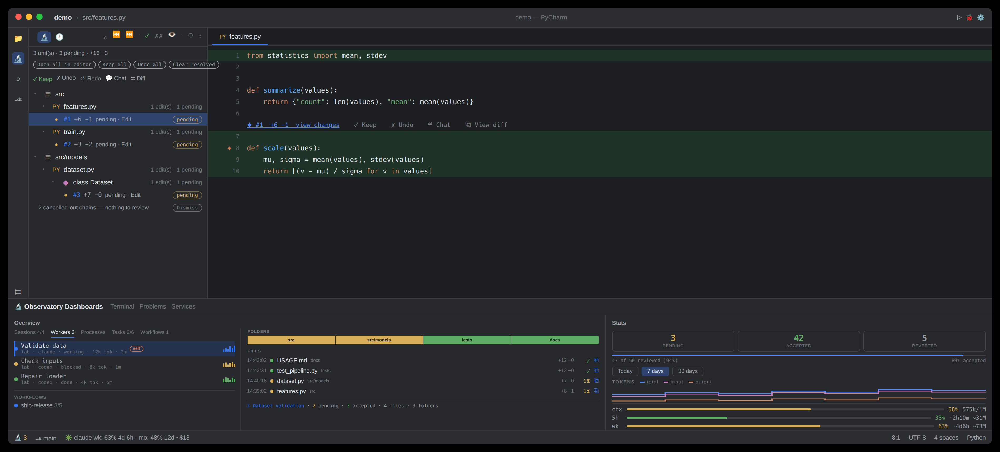

# OAK for JetBrains IDEs

Per-edit **Keep / Undo** for [Claude Code](https://claude.com/claude-code) and Codex on established and
mission-critical codebases, in PyCharm, IntelliJ, WebStorm, GoLand, and every other JetBrains IDE
(platform-only APIs — no language plugin required).
The same store, engine, and review model as the CLI and the VS Code extension: all three front-ends
stay in sync because they read and write the same `~/.claude/claude-observatory` store.



See the full feature tour in the [main README](../../README.md#what-you-get); the notes below are
JetBrains-specific.

## Requirements

- A JetBrains IDE **2025.2+**
- The `oak` CLI on this machine (the plugin drives it for every store mutation —
  undo/redo correctness lives there, deliberately). Install it via the [one-command bootstrap](https://github.com/cell-observatory/oak-observatory#install), or from a release tarball: `npm i -g --allow-scripts=node-pty ./oak-observatory-<ver>.tgz`, then `oak doctor --fix`
- Capture hooks installed: `oak init --with-statusline` (with Claude Code closed;
  `--with-statusline` also enables the 5h/week Usage bars)

## Install

**With the CLI (any platform, no bash needed):**

```bash
oak install-extensions --jetbrains-only     # downloads + installs, then restart the IDE
```

**From a GitHub Release, by hand:** download `oak-observatory-jetbrains-<ver>.zip` → Settings →
Plugins → ⚙ → **Install Plugin from Disk…** → restart.

**From this repo:**

```bash
./scripts/install-jetbrains.sh   # builds, then installs via the CLI, then restart the IDE
```

IDE detection lives in the CLI, which covers macOS (`~/Library/Application Support/JetBrains`), desktop
Linux (`~/.local/share/JetBrains`), Windows (`%APPDATA%\JetBrains` — natively, from PowerShell or cmd,
not only Git Bash), and JetBrains Remote Development backends (`~/.config/JetBrains/RemoteDev-*`), so it
also works when run on an SSH host.

## Auto-updates

Install-from-Disk (and `install-jetbrains.sh`) is a one-time side-load — it does **not** auto-update.
To have the IDE keep the plugin current on its own, add the self-hosted plugin repository **once**:

**Settings → Plugins → ⚙ → Manage Plugin Repositories → +**, then paste:

```
https://github.com/cell-observatory/oak-observatory/releases/latest/download/updatePlugins.xml
```

New releases then appear under **Settings → Plugins → Updates**, exactly like a Marketplace plugin —
this repository descriptor is regenerated and attached to every GitHub Release. To follow the
**pre-release channel** (the rolling build of the `dev` branch) instead, subscribe to its descriptor
rather than the one above:

```text
https://github.com/cell-observatory/oak-observatory/releases/download/dev-latest/updatePlugins.xml
```

That update check is the IDE's own: it reads the repository, which OAK cannot steer for one install.
A local build of the plugin (its version ends in `-dev.0`, as every build of a `dev` checkout does) is
left alone by the version chip and by `oak update`, but the IDE can still offer the repository's build
over it. Decline that update in **Settings → Plugins → Updates** to keep the local build.

(Prefer the terminal or the Overview's version chip? `oak update` refreshes the plugin
in place from your channel's newest release — `--channel dev` / `--channel stable` switches channels —
and the chip at the right edge of the Overview toolbar does the same from inside the IDE; restart the
IDE afterward. To show whether the plugin or the CLI differs from your channel's newest release (a dot beside
the version, for a newer release or an install above the channel), the chip runs `oak version --check`, which
reads the release list from GitHub, about once an hour while the Overview is open, and every five
minutes until a read succeeds. The full channel story: [Releases & channels](https://cell-observatory.github.io/oak-observatory/releases.html).)

## Remote development (Gateway / Toolbox over SSH)

The plugin runs **on the host** — platform-only APIs, no JCEF — which is exactly where `~/.claude`,
the store, and Claude Code live; the tool windows and status bar are remoted to the JetBrains
Client. Install it on the host with the script above (in the remote terminal), and install the
CLI + hooks + status line on the remote too. One caveat: the backend isn't a login shell, so
`CLAUDE_CONFIG_DIR`/PATH exports in shell profiles don't reach it — if the CLI or store isn't
found, set both explicitly in **Settings → Tools → OAK**. Full walkthrough:
[main README → Remote development](../../README.md#remote-development-ssh--devcontainers).

## What you get

| Surface | Where |
| --- | --- |
| **Review / File History** (the **Review** tab is THE review surface: the session's changes as a **tree** — folder → file → class → unit — with a counts header (carrying an inline **Search** field — substring, or a regex when the text carries regex syntax — a **Filter** dropdown for file-type / extension, and a **Sort** dropdown (four orders — newest, oldest, A→Z, Z→A), the Filter and Sort buttons each naming their own state), Open all / Keep all / Undo all / Clear resolved above it, each file stamped with its last-change time, a labelled Keep · Undo · Redo · Chat · Diff toolbar for the selected row, and a cancelled-out footer with Dismiss; resolved rows stay greyed with redo/revert, and **Open all in editor** stacks the pending work as one hunks-only view (VS Code shows the same units as a flat list grouped by file — the model is shared, the presentation follows each IDE); **File History** is a flat, chronological list of just the active file's edits that follows the editor) | "Observatory Traces" tool window, left stripe |
| **Feed · Prompts · Observations · Actions** — the Feed reads the native conversation with reasoning, tools and captured diffs, and follows the selected worker, task or shell. Prompts scope review, and Group Tabs shows the readers side by side. New Session starts an agent in herdr. | Observatory Timeline |
| **Overview · Stats** side-by-side panes. The **Overview** is the flagship **master–detail** view: a **Sessions · Workers · Processes · Tasks · Workflows** nav on the left (named Claude Code and Codex agents from herdr, OAK-started agents and recent repository worktrees, with machine, kind, OAK state, tokens and last activity; nested subagents hide when finished under Active only and fold into an expandable count when shown; orchestration runs; Claude's own numbered to-dos with their ±lines / edits / pending rollups; the background shells this session left running; and sessions from every machine in one list, newest activity first across machines; remote rows keep their machine badge and machine state stays above the rows; Search, Active and Sort cover the whole list, with titles and statistics, and under each session its workers still at it, in a group a click opens), and the selected item's change map on the right (a Folders strip, a churn-ranked Files ledger with each file's last-change time, and a summary bar; selecting a row opens that selection's feed in the Timeline's **Feed** tab — a live tail while the agent, run, task, or shell is still working, an audit log once it has finished). Selecting a local **Sessions** row pins what the whole observatory reviews; mirrored transcripts and bridge pointers without a local conversation are excluded. The other nav tabs only re-point this panel. Stats leads with a live **review scoreboard** — pending / accepted / reverted counts + a progress bar — over the tokens plot | "Observatory Dashboards" tool window, bottom stripe |
| **Review nav bar** — a top row of session controls (the name of the session under review, as a label — the **Sessions** tab and the Timeline's selector are where it changes · Accept All · Reject All · Clear Resolved · Export · an inline **Search** field (substring, or a regex when the text carries regex syntax) · **Filter** (file-type / extension, its button naming what is applied) · **Sort** (four orders — newest, oldest, A→Z, Z→A; its label names the one in force) · **Active only**, on by default and remembered · Clear completed · Spotlight · Refresh) over a bottom row of four review axes — **Diff · File · Folder · Prompt** — that step the pending edits at four granularities. The Prompt axis carries **Rewind to before this prompt**, which reverts every unreviewed edit from that ask *onward*; its confirmation states the records and the review units it will revert, and the toast that follows offers **Redo the rewind** for exactly those edits | Overview pane, above the change map |
| **Floating review bar** — a true overlay on the platform's own `editorFloatingToolbarProvider` layer, over any editor whose file still has unreviewed edits: **Keep · Undo · Chat · View diff · ‹ `Diff n/m` › · Accept File · Reject File · Spotlight · Clear Resolved**. It stays up while the file has pending edits rather than hiding on pointer-exit, and it is the **default** in-editor surface since 0.10.0 — `editorReviewSurface` chooses it, the notification banner it replaced, both, or neither | every main editor |
| **Inline menu** — `✦ #N  +A −R  ·  edit n/m in file  ·  file i/k  view changes` (opens the edit's inline diff) then `✓ Keep · ✗ Undo · ❝ Chat · ⧉ View diff` on the lens above each pending edit; a **✨ gutter star** (click to open the diff), a subtle green/red line tint, removed lines drawn as italic **ghost text**, a **Claude-coral error-stripe** marker | every editor |
| **Click → inline diff** — the edit's before ⟷ after opens **unified**, with Claude's reasoning in the title and `Keep · Undo · Chat` on the diff toolbar; **Spotlight** dims the unedited lines (the floating review bar, the status-bar nav bar, the Overview toolbar — and the editor banner when `editorReviewSurface` enables it) | every editor |
| **🔬 scoreboard** — pending count, accept rate, oldest pending; click = review next | status bar |
| **OAK sync** — once sync is in use on this machine (a run set it up, a backup is chosen, or a conflict is open; otherwise nothing shows): the last run's time, or the open conflicts, or a failure, with the last run a machine a line in the CLI's words and the backup with its key's fingerprint in its tooltip. A click (or **OAK: Sync…**) opens its menu: **Sync Now** (a cancellable progress bar, then what the run pulled, the conflicts it left, each machine that failed and its warnings), each open conflict, **Set Up Sync…** or **Change the Backup…** (nowhere else, a saved machine, or a folder; for a folder holding a backup this machine has no key for, the key copied from a saved machine or pasted), **Machines and Projects…** (an unticked one is `oak sync exclude`d), **This Machine Is a Reinstall…** when a run refused the backup folder's record, and **The Last Run** as `oak sync status` prints it. The Overview's **Sessions** tab lists the open conflicts above the workspaces: a click offers **Open Both Copies** (the other machine's beside yours, in a diff) and **Delete <machine>'s Copy (Yours Stands)** (`oak sync resolve`) | status bar · Overview |
| **Keyboard loop** — `⌥⌘X` (`Ctrl+Alt+X` on Windows/Linux), then a letter, the terminal app's where it has one: `n` review next · `p` previous · `a` keep at cursor · `u` undo at cursor · `⇧a` / `⇧d` keep / undo all edits in the file · `[` / `]` step file revisions in a diff · `c` add a review comment · `h` jump to the next session waiting on you on this machine (the Sessions tab lists the other machines' too) | global |

On Windows, `Ctrl+Alt` is also AltGr, so a keyboard layout where AltGr+X types a character (`ź` in
Polish, `#` in Hungarian or Czech) loses that character to the `Ctrl+Alt+X` prefix. To use another
prefix, open **Settings → Keymap**, search for `OAK:`, and rebind each action.

The sidebar window's tabs carry an icon and a label, and the tool-window stripe shows a **pending
badge**. The plugin tracks the VS Code extension **feature-for-feature** — every surface (the
master–detail Overview, the Fleet across worktrees, the Prompts window and its prompt-scoped
review, the context-preloaded **💬 Chat** handoff) ships in both. All panels refresh in **real time**
on any tool call — a `TranscriptWatcher` watches the session transcripts — and share throttled CLI
fetches (≤1 spawn per view per ~3s), so live views stay cheap.

Try it without Claude: `oak demo` replays a scripted session live through the real
pipeline in an isolated `demo-*` session — every panel fills in, and review genuinely works.
`oak demo --clean` removes every trace.

Undo is surgical (position-anchored 3-way merge, via the CLI): reverting one edit preserves later
edits to the same file; genuine overlaps surface a conflict dialog with a **Force-restore** option.
Unsaved files prompt **Save & Continue** before any disk-writing operation.

## Settings

**Settings → Tools → OAK**: paths for the `oak` and `claude` CLIs
(blank = auto-detect), a `CLAUDE_CONFIG_DIR` override (for relocated config dirs, for example
devcontainer volumes), a pinned session (blank = auto-resolve the newest), the inline-overlay toggle,
and a **unified diff** toggle (open edit diffs in the inline red/green viewer instead of side-by-side).

Three more arrived in 0.10.0:

- **Review controls in the editor** — *Floating bar over the code* (the default), *Banner above the
  editor* (the pre-0.10 behaviour), *Both*, or *Neither*. Stored as `editorReviewSurface`; an
  unrecognized value reads as the floating bar rather than as nothing.
- **After keeping or reverting one edit, open the next edit still awaiting review** — on by default.
  It crosses into another file when that is where the next edit is. Bulk operations, task operations
  and redo never move you, and neither does a resolve that did not happen (a refusal, an unsaved
  buffer, a cancelled conflict). Turning it off also stops the floating review bar from following.
- **Group all tabs side by side (Sessions · Workers · Processes · Tasks · Workflows)** — off by
  default; it trades change-map width for seeing all five of the Overview's nav tabs at once. The
  Timeline's own four-column mode is a separate toggle, **Group Tabs**, beside that window's tab strip.

**Sync across machines (oak sync)**, on the same page, shows sync's state from `oak sync status` (the backup, the last
run a machine a line, the open conflicts and the warnings) and changes it through the CLI: **Sync Now**, **Set Up or
Change the Backup…**, **Machines and Projects…**, and **This Machine Is a Reinstall…** when a run refused the backup
folder's record. Its settings stay in OAK's `prefs.json`, which the CLI writes, so Apply and Reset leave them alone.

## Architecture (for contributors)

The plugin is a Kotlin **front-end over the TypeScript core**, never a re-implementation:

- **Mutations & diff-dependent reads** → the `oak` CLI (`undo/redo --json`,
  `locate` for live-buffer line mapping, `stats/usage/observe --json`). The 3-way undo engine is
  correctness-critical and lives in one place.
- **Cheap reads** → straight off disk (`log.jsonl` + status-op folding, content-addressed blobs,
  session resolution) — schemas match core's `store.ts`/`session.ts`, locked in by the unit tests
  in `src/test/kotlin` (`./gradlew test`).
- **Live refresh** → a `TranscriptWatcher` (per-directory `nio` watches with dynamic new-dir handling
  and an ENOSPC→poll fallback) refreshes every panel on any tool call; panels share one throttled CLI
  fetch per view (≤1 spawn per view per ~3s), mirroring VS Code's webview throttle.
- **Stats plots** → native Swing (no JCEF): step-line charts + usage bars that track pane width.

```bash
./gradlew test buildPlugin   # unit tests + build/distributions/oak-observatory-jetbrains-<ver>.zip
./gradlew runIde             # throwaway sandbox IDE with the plugin preloaded
./scripts/install-jetbrains.sh   # (from repo root) build + install into your real IDE
```

Agent terminals belong to **herdr** (`oak doctor --fix` installs the pinned backend). OAK derives the lifecycle
states of agents started from briefs and lists them in Workers.
Chat about an edit, review comments, and quote actions prepare an editable draft, in a dialog, with an
explicit **Send to agent** choice. OAK submits through core to the session's live herdr pane;
failed or unavailable sends retain the clipboard draft. Comments stay unsent until acknowledgement.
Machines are saved with `oak machine add`, which replaces the `remotes` command. Usage is measured on each
machine for itself; where this machine has no current reading of the Claude account's 5-hour or weekly
share, the Stats panel shows a saved machine's reading of the same account (with no
Claude Code login here, of the one account the saved machines name) and name it. An account with no five-hour
limit, whose usage answer carries no 5-hour window (as a verified Ultra plan's does), shows no 5-hour readout in
the Stats panel, and the status bar shows none for any plan. The status bar shows weekly and monthly usage, with the month's dollar
figure after its `mo` reset, as the Claude Code status line shows it: the estimate at today's list prices, marked `~`, or, on a plan with
no rolling windows, the spend Claude Code reported. The token and dollar
estimates count each message of the account once, across this machine and every machine whose usage the
local database holds, and the tooltip and the Stats panel name those machines. To read it, OAK runs
`oak __usage-records --json` on each enabled saved machine over SSH, in the background, at most every five
minutes while the plugin runs (not on a machine whose record log `oak sync` keeps current here);
`"machineUsage": false` in `~/.claude/claude-observatory/prefs.json` turns that off. `oak server` is only the local TUI focus endpoint.

The Timeline’s **Feed** tab reads prompts, replies, reasoning, tool calls and captured
edits from the selected native transcript.
Run `oak machine add build-box user@host` to register a remote host. Switch Session, the Timeline selector
and the Overview’s Sessions list every enabled saved machine's sessions in one list with this machine's, newest
first unless sorted otherwise, each row naming its machine; the Overview's Workers lists each machine's workers
under its label. They share parallel background reads of `oak sessions --json --machine <label>`, at least ten
seconds apart, with a 45-second remote deadline. Cached rows show immediately; one line per machine above the
rows gives the age of its last answer, or the reason its last read failed and when it last answered, and a
failed machine's rows go. Picking a remote session reads Review, Feed, Prompts, Observations, Actions and Overview there.
Keep, Undo, Resolve, comments, quotes and prompts run there too. Opening uses a verified mount or the editor’s SSH remote window, with Diff available separately. Review retains its counts, prompt scopes, Search, Filter and Sort, and actions run on the selected machine. The saved machine needs an OAK build supporting the Review view batch; unsupported views are reported. Switch Session also lists synced records read-only with an offer to fetch them here.
The terminal app retains its machine tree and jumps to herdr panes. The [Database & sync](https://cell-observatory.github.io/oak-observatory/database-and-sync.html) guide
explains the local database, `oak sync`, the backup and how usage is counted across machines. `oak doctor --fix` repairs the local herdr setup.

Worker rows open their own live log in the Timeline Feed panel. A worker on a saved machine reads there over SSH every ten seconds. The log shows its exact recorded end time and stays readable; a resumed worker updates again. In-process workers get no herdr tab.

### Remote tasks, conversation search and replies

Task Keep, Undo, Clear and Clear Completed run on the selected machine through `task-keep`, `task-undo` and `task-clear --machine`; a remote failure never falls back to a local task. Search Conversations asks this machine and enabled saved machines concurrently, with the shared 45-second remote deadline (and five seconds for the CLI to return). Every hit names its machine; selecting it reviews that session there. Partial failures keep successful hits and name the machines that could not answer.

The Review keyboard loop opens remote display units through the same mount-first, then SSH route. Use Ctrl+Alt+X (Cmd+Alt+X on macOS), then N/P for next/previous edit or Right/Left for next/previous changed file. Single-edit Keep/Undo continues after a fresh remote read confirms resolution when Reveal Next on Resolve is enabled. Replies stay in Timeline/Feed, quotes and review comments.

### Review a session on another machine

Use **Open workspace window** on a session in Observatory’s Sessions list or a session picker (right-click its row) to open that workspace locally or on its saved machine. Missing folders and sessions with no workspace are refused; JetBrains uses Gateway or shows SSH connection instructions.

The window pins the session and opens its pending changes stacked (ten per page), or says nothing is pending without opening an empty tab. Review, File History, Timeline and the Overview are revealed in their saved locations; the Overview shows Sessions, Workers, Processes, Tasks and Workflows side by side with the change map. One terminal named **OAK** runs `oak`; an existing OAK terminal is reused. JetBrains requires its Terminal plugin for the terminal. Already-open windows pick up the request too. Each request is consumed once and expires after ten minutes.


Prefer one editor window per machine and workspace over a multi-root workspace of mounted folders. OAK, git and file watching then run on the owning machine, and a slow network share or stalled extension host does not hold up every workspace.

Select a saved machine’s session in OAK. **Open all in editor** opens a stacked review in this window, ten changes per page. Each page is read in one bounded call; Keep, Undo and Redo run on the saved machine and refresh the block. Missing files show their recorded changes. The side-by-side switch uses a verified mount when available and recorded before/after otherwise. **Open on <machine>** and a filename first use a verified mount for editing. Linux and macOS mount tables identify the saved host’s home share or a network share mounted on both machines. A coincidentally identical local pathname is never enough. Mounted files remain editable, with highlights, inline review controls and File History. Keep, Undo, Redo and Resolve always run on the saved machine with `--machine`; OAK refreshes after each action to account for delayed SMB notifications.

Without a matching mount, VS Code and Cursor open a new Remote-SSH window at the session’s workspace using the saved SSH target. JetBrains opens its [documented Gateway connect link](https://www.jetbrains.com/help/idea/remote-development-a.html). A request written on that machine selects the session and opens the requested edit or file when OAK starts there. It expires after ten minutes and can be consumed only once. The remote window has the normal editable files, highlights, inlays and review controls.

If OAK is missing on the remote editor server, the editor offers `oak install-extensions --machine <label>`. Connect once first if that editor’s server has not been installed. If Gateway is absent or no remote IDE path is available, the dialog gives the target and workspace for **File → Remote Development → SSH → New Connection**. If the request expires, select the session in that window’s OAK.

The original window still lists remote edits and runs review actions there. **Diff** opens a native before/after view using contents read from the saved machine, falling back to a patch with an older CLI. Replies stay in Timeline/Feed, quotes and review comments; Review has no reply box.

Processes always follows Workers in the Overview tabs and grouped columns, including for sessions on a saved machine. An empty list says “No shells in this session”; pending and failed reads keep the panel visible. Turn off Active only to include finished shells. Selecting any shell opens its output in Timeline’s Feed; saved-machine lists and feeds use `--machine` with the shared deadline.

### Done sessions

The Overview’s Sessions list keeps Active only on by default, hiding inactive, fully reviewed sessions. With it off, recorded completions fold into one **▸ N done** row per machine, closed at first. Click to show them grouped by workspace. The panel remembers open folds while it lives. A done session folds even with edits left to review, and the fold row counts them (**▸ N done · M pending**). The reviewed session and active workers stay visible; a new turn leaves the fold. Search reveals matching done sessions that pass Active only.
