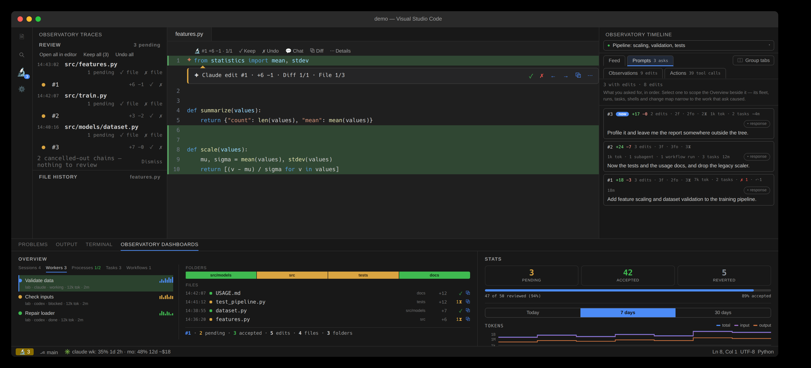

# OAK

A running list of every file change **Claude Code** and **Codex** make — each with its own **Keep** / **Undo** — right in the VS Code sidebar. Git-free, surgical, and it costs **zero extra model tokens** (edits are captured by local hooks, outside the model loop). It is built for **established and mission-critical codebases** rather than throwaway prototypes.

Think of it as the Cursor "keep/undo each change" experience, but for Claude Code and Codex, and shareable with your team.



## Setup

1. Install the capture hooks once (this writes OAK's capture hooks into `~/.claude/settings.json`):

   ```bash
   oak init
   ```

   (No `oak` CLI yet? Use the [install one-liner](https://github.com/cell-observatory/oak-observatory#quickstart), or download `oak-observatory-<version>.tgz` from a [release](https://github.com/cell-observatory/oak-observatory/releases) and run `npm install -g --allow-scripts=node-pty ./oak-observatory-<version>.tgz`, then `oak doctor --fix`. Install the hooks while Claude Code is **not** running, then launch it.)
2. Open the **Observatory Traces** view in the Activity Bar (the microscope icon, badged with the pending-edit count). As Claude edits files, they appear in the **Review** list — one row per change, grouped by file.

> **Remote-SSH / devcontainers / WSL:** this extension runs on the **workspace host**, so install it — along with the `oak` CLI, the status line, and the capture hooks — **on the remote**, where `~/.claude` lives (not on your laptop). See the main repo's [Remote development guide](https://github.com/cell-observatory/oak-observatory#remote-development-ssh--devcontainers).

## Updates

The extension installs from a **GitHub Release** `.vsix` (the install one-liner, or `oak update`). A background check of GitHub Releases, when a window opens (at most once a day after a check that succeeds), offers a one-click **Update now** whenever your installed version *differs* from the channel you follow, except to a local build (a version ending in `-dev.0`, which every build of a `dev` checkout carries and no release does), which **Update now** also leaves alone — trigger it anytime from the Command Palette: **“OAK: Check for updates.”** Its **Update now** is the version chip's: it installs this extension, then runs `oak update` for everything else, the saved machines included. The Overview's version chip also reads the release list when the Overview or its menu opens, at most once an hour after a read that succeeds; a failed read is retried on the next open. The downloaded `.vsix` is sha256-verified and installs through the editor's own extension service, so nothing is needed on your `PATH`. GitHub Releases serve both the stable channel and the **Pre-release (dev) channel**.

## Views

The **review surfaces** live in the Activity Bar (icon-only tabs; the microscope icon is badged with the pending count); the **observatory dashboards** live side-by-side in the bottom panel (like Terminal/Problems). A **status-bar microscope** shows the pending count in realtime (amber while anything awaits review), with the full **review scoreboard** in its tooltip.

- **Overview** (bottom panel) — the flagship **master–detail** view. A left nav of **Sessions** (sessions from every machine in one list, newest activity first across machines; remote rows keep their machine badge and machine state stays above the rows; Search, Active and Sort cover the whole list, with titles and statistics, and under each session its workers still at it, in a group a click opens), **Workers** — Claude Code and Codex agents from herdr, OAK-started agents, recent repository worktree sessions and the reviewed session's subagents, named by tab or session title, with machine, kind, OAK state, tokens and last activity; Active only hides finished workers and subagents, which fold into an expandable count when shown — then **Processes** (shells recorded for this session and its workers, including Codex exec sessions), **Tasks** (Claude's own numbered to-dos, each with its ±lines / edits / pending rollup), and **Workflows** (orchestration runs). Selecting a local Sessions row pins what the whole observatory reviews; mirrored transcripts and bridge pointers without a local conversation are excluded. The other tabs re-point the panel alone. The right pane is the selected item's change map: a **Folders strip**, a churn-ranked **Files ledger** sized by ±lines and each file stamped with the exact time of its last change, and a summary bar; selecting a row opens that selection's **feed** in the Timeline's **Feed** tab — a live tail while the agent, run, task, or shell is still working, an audit log once it has finished. Its two-row toolbar steps the pending edits on four review axes — **Diff · File · Folder · Prompt** — and carries the session controls, among them an inline **Search** field (matched as a substring, or as a regex the moment the text carries regex syntax), a **Filter** dropdown (file-type buckets and extensions, its button naming what is applied), a **Sort** dropdown (four orders — newest, oldest, name A→Z, name Z→A; its label names the one in force), and **Active only**: on by default, remembered across hides and restarts, and hiding finished agents, runs, shells, and fully-reviewed work.
- **Feed** (Observatory Timeline) — the native conversation of the selected session (prompts, replies, thinking, tool calls, diffs), or the activity of the selected worker, task or shell. Prompts scope review; Observations and Actions retain the recap and audits. New Session starts an agent through herdr.
- **Review · File History** (Observatory Traces, Activity Bar) — the session's changes as one list, grouped by **file**: pending rows first-class with per-unit and per-file **Keep / Undo**, resolved rows greyed (undone offers **↻ redo**, kept offers **↺ revert**), **Open all in editor** for the pending work as one stacked inline view — the IDE's own syntax highlighting kept inside the green/red bands, lines wrapped to the window, **Keep · Undo** on every block (a decided block keeps its revert/redo), with **Spotlight** and a **Side by side** switch in its bar; an inline header toolbar — a **Search** field (substring, or a regex when the text carries regex syntax), a **Filter** dropdown (file-type / extension), and **Sort** (a dropdown of four orders — newest, oldest, A→Z, Z→A), each naming its own state — with each file header stamped with its last-change time; plus the active file's history. In the editor, each edit gets a **✨ gutter star**, a subtle green/red line tint, a coral ruler mark, and an inline **🔬 #N · +A −R · n/m** menu (**✓ Keep · ✗ Undo · 💬 Chat · ⧉ Diff · ⋯ Details**).
- **The floating review bar** — while the open file has edits awaiting review, a compact bar floats over the code at the current edit: a live **Claude edit #N · +A −R · Diff n/m · File i/k** title with **Keep · Undo · ⌃⌄ · ‹› · ⧉ Diff · 💬 Chat · 💡 Spotlight · ⌄** beside it. It follows as you keep, undo and step, and never steals focus. One axis runs the two surfaces: **⌄** opens the full **review bubble** (Claude's reasoning + the diff in git's own colors), and VS Code's own **^** — the same chevron rotated — goes back down, bubble → bar, then bar → hidden. `claudeObservatory.editorReviewSurface` picks the bar, the bubble, or neither.
- **Stats** (bottom panel) — a live **review scoreboard** over token/usage plots.
- **oak sync** (status bar) — once sync is in use on this machine (a run set it up, a backup is chosen, or a conflict is open; otherwise nothing shows), an **OAK sync** item shows the last run's time, or the open conflicts, or a failure, and its tooltip lists the last run a machine a line in the CLI's words, with the backup and its key's fingerprint. A click opens **OAK: Sync**: **Sync now** (a cancellable progress notification, then what the run pulled, the conflicts it left, each machine that failed and its warnings), each open conflict, **Set up sync…** or **Change the backup…** (nowhere else, a saved machine, or a folder; for a folder holding a backup this machine has no key for, the key copied from a saved machine or pasted), **Machines and projects…** (an unticked one is `oak sync exclude`d), **This machine is a reinstall…** when a run refused the backup folder's record, and **The last run** as `oak sync status` prints it. The Timeline's session list groups the open conflicts above the sessions, each with **open both** (the other machine's copy beside yours, in a diff) and **delete the copy** (`oak sync resolve`). Sync's settings stay in OAK's `prefs.json`, which the CLI writes, so they are not VS Code settings: OAK: Sync changes them, as **Store location** changes where the store is.
- **💬 Chat** — on any action, edit, subagent, or task: hands your own Claude a **context-preloaded** prompt (the target, Claude's reasoning, and the diff or command/result). **Zero-token** — Observatory never calls a model.

The review loop is keyboard-driven, with one prefix, **⌥⌘X** (`ctrl+alt+x` on Windows and Linux), then a letter, the terminal app's where it has one: **n** jumps to the oldest pending edit and **p** steps back, **a** keeps it, **u** undoes it, **⇧a** / **⇧d** keep or undo every edit in the file, **[** / **]** step a file's revisions, **c** comments on a line of an edit's diff, and **h** jumps to the next session waiting on you on this machine (the session selector lists the other machines' too). Keep/Undo operate on the same store as the `oak` CLI, so the two stay in sync.

The prefix has two known collisions. The LaTeX Workshop extension binds `ctrl+alt+x` (`⌥⌘X` on macOS) to its own sidebar view, so with both extensions installed the two bindings compete for the chord; setting `latex-workshop.bind.altKeymap.enabled` to `true` moves LaTeX Workshop's shortcuts to `ctrl+l alt+<key>` (`⌘L ⌥<key>` on macOS) and frees it. On Windows, `ctrl+alt` is also AltGr, so a keyboard layout where AltGr+X types a character (`ź` in Polish, `#` in Hungarian or Czech) loses that character to the chord. To use another prefix, open **Keyboard Shortcuts** (`ctrl+k ctrl+s`, `⌘K ⌘S` on macOS), search for `claudeObservatory.`, and rebind each command; the `c` chord is bound to `workbench.action.addComment`, so rebind that one too.

Try it without Claude: `oak demo` replays a scripted session live through the real pipeline in an isolated `demo-*` session — every panel fills in, and review genuinely works. `oak demo --clean` removes every trace.

See the full feature tour in the [main README](https://github.com/cell-observatory/oak-observatory#what-you-get).

## What's captured

Tool edits (`Edit`, `Write`, `MultiEdit`, `NotebookEdit`) plus files changed by `Bash` commands (set `CLAUDE_OBSERVATORY_NO_BASH=1` to opt out). Text files over 5 MB and binary files over 25 MB are skipped; smaller binary files are captured as opaque blobs.

Agent terminals belong to **herdr** (`oak doctor --fix` installs the pinned backend). OAK derives the lifecycle
states of agents started from briefs and lists them in Workers.
Chat about an edit, review comments, and quote actions prepare an editable draft (**Edit first…** opens it
as a document) with an explicit **Send to agent** choice. OAK submits through core to the session's live herdr pane;
failed or unavailable sends retain the clipboard draft. Comments stay unsent until acknowledgement.
Machines are saved with `oak machine add`, which replaces the `remotes` command. Usage is measured on each
machine for itself; where this machine has no current reading of the Claude account's 5-hour or weekly
share, the Stats panel shows a saved machine's reading of the same account (with no
Claude Code login here, of the one account the saved machines name) and name it. An account with no five-hour
limit, whose usage answer carries no 5-hour window (as a verified Ultra plan's does), shows no 5-hour readout in
the Stats panel, and the status bar shows none for any plan. The status bar shows weekly and monthly usage, with the month's dollar
figure after its `mo` reset, as the Claude Code status line shows it: the estimate at today's list prices, marked `~`, or, on a plan with
no rolling windows, the spend Claude Code reported. The token and dollar
estimates count each message of the account once, across this machine and every machine whose usage the
local database holds, and the tooltip and the Stats panel name those machines. To read it, OAK runs
`oak __usage-records --json` on each enabled saved machine over SSH, in the background, at most every five
minutes while the extension runs (not on a machine whose record log `oak sync` keeps current here);
`"machineUsage": false` in `~/.claude/claude-observatory/prefs.json` turns that off. `oak server` is only the local TUI focus endpoint.

The Timeline’s Feed tab reads prompts, replies, reasoning, tool calls and captured edits from the selected native transcript.
Save a machine with `oak machine add <label> <ssh-target>`. VS Code lists each saved machine's sessions in its session selectors, Sessions and Workers; the selectors and Sessions show every machine's sessions in one list, newest first unless sorted otherwise, with one line per machine above the rows. Parallel background
reads share one cache per machine, refreshed at most once per ten seconds with a 45-second deadline, answer age
and visible errors. Selecting a saved machine's session reads Review, Timeline and Overview there; review actions run
on that machine, as do comments, quotes and prompts. Opening uses a verified mount or the editor’s SSH remote window, with Diff available separately. Review retains its counts, prompt scopes, Search, Filter and Sort, and actions run on the selected machine. The saved machine needs an OAK build supporting the Review view batch; unsupported views are reported. Records brought by sync from a machine that is not saved are read-only,
with an offer to fetch the session here (`oak sync fetch`).

Worker rows open their own live log in the Timeline Feed panel. A worker on a saved machine reads there over SSH every ten seconds. The log shows its exact recorded end time and stays readable; a resumed worker updates again. In-process workers get no herdr tab.

Saved-machine session selectors and the Overview’s worker rows share one cached background listing per machine.
Opening both does not start another remote read; a failed refresh removes that machine’s stale worker rows too.

### Remote tasks, conversation search and replies

Task Keep, Undo, Clear and Clear Completed run on the selected machine through `task-keep`, `task-undo` and `task-clear --machine`; a remote failure never falls back to a local task. Search Conversations asks this machine and enabled saved machines concurrently, with the shared 45-second remote deadline (and five seconds for the CLI to return). Every hit names its machine; selecting it reviews that session there. Partial failures keep successful hits and name the machines that could not answer.

The Review keyboard loop opens remote display units through the same mount-first, then SSH route. Use Ctrl+Alt+X (Cmd+Alt+X on macOS), then N/P for next/previous edit or Right/Left for next/previous changed file. Single-edit Keep/Undo continues after a fresh remote read confirms resolution when Reveal Next on Resolve is enabled. Replies stay in Timeline/Feed, quotes and review comments.

### Review a session on another machine

Use **Open workspace window** on a session in Observatory’s Sessions list or a session picker (the window button) to open that workspace locally or on its saved machine. Missing folders and sessions with no workspace are refused; JetBrains uses Gateway or shows SSH connection instructions.

The window pins the session and opens its pending changes stacked (ten per page), or says nothing is pending without opening an empty tab. Review, File History, Timeline and the Overview are revealed in their saved locations; the Overview shows Sessions, Workers, Processes, Tasks and Workflows side by side with the change map. One terminal named **OAK** runs `oak`; an existing OAK terminal is reused. JetBrains requires its Terminal plugin for the terminal. Already-open windows pick up the request too. Each request is consumed once and expires after ten minutes.


Prefer one editor window per machine and workspace over a multi-root workspace of mounted folders. OAK, git and file watching then run on the owning machine, and a slow network share or stalled extension host does not hold up every workspace.

Select a saved machine’s session in OAK. **Open all in editor** opens a stacked review in this window, ten changes per page. Each page is read in one bounded call; Keep, Undo and Redo run on the saved machine and refresh the block. Missing files show their recorded changes. The side-by-side switch uses a verified mount when available and recorded before/after otherwise. **Open on <machine>** and a filename first use a verified mount for editing. Linux and macOS mount tables identify the saved host’s home share or a network share mounted on both machines. A coincidentally identical local pathname is never enough. Mounted files remain editable, with highlights, inline review controls and File History. Keep, Undo, Redo and Resolve always run on the saved machine with `--machine`; OAK refreshes after each action to account for delayed SMB notifications.

Without a matching mount, VS Code and Cursor open a new Remote-SSH window at the session’s workspace using the saved SSH target. JetBrains opens its [documented Gateway connect link](https://www.jetbrains.com/help/idea/remote-development-a.html). A request written on that machine selects the session and opens the requested edit or file when OAK starts there. It expires after ten minutes and can be consumed only once. The remote window has the normal editable files, highlights, inlays and review controls.

If OAK is missing on the remote editor server, the editor offers `oak install-extensions --machine <label>`. Connect once first if that editor’s server has not been installed. If Gateway is absent or no remote IDE path is available, the dialog gives the target and workspace for **File → Remote Development → SSH → New Connection**. If the request expires, select the session in that window’s OAK.

The original window still lists remote edits and runs review actions there. **Diff** opens a native before/after view using contents read from the saved machine, falling back to a patch with an older CLI. Replies stay in Timeline/Feed, quotes and review comments; Review has no reply box.

Processes always follows Workers in the Overview tabs and grouped columns, including for sessions on a saved machine. An empty list says “No shells in this session”; pending and failed reads keep the panel visible. Turn off Active only to include finished shells. Selecting any shell opens its output in Timeline’s Feed; saved-machine lists and feeds use `--machine` with the shared deadline.

### Done sessions

The Overview’s Sessions list keeps Active only on by default, hiding inactive, fully reviewed sessions. With it off, recorded completions fold into one **▸ N done** row per machine, closed at first. Click to show them grouped by workspace. The panel remembers open folds while it lives. A done session folds even with edits left to review, and the fold row counts them (**▸ N done · M pending**). The reviewed session and active workers stay visible; a new turn leaves the fold. Search reveals matching done sessions that pass Active only.
